# Identity for AI Agents You Don't Control - Powered by ThunderID

*A demo from the Internet Identity Workshop (IIW 43) demo hour, written up so you can read how it works and run it
yourself.*

An AI agent arrives at your service, but you don't control it. How do you establish its identity and who it acts
for? This sample shows how a user can **register** their agent with your service, give it **distinct
credentials**, **delegate** access, and **revoke** that access, using open-source
[ThunderID](https://thunderid.dev).

## Credits

**The demo was built by [sajitha-tj](https://github.com/sajitha-tj):** the Sample Bank portal and admin
dashboard, the bank API, the agent's toolkit and skill, the sample email inbox, and the ThunderID configuration
and flows they run on. Thank you!

<picture>
  <source media="(prefers-color-scheme: dark)" srcset="docs/images/trust-boundary-dark.svg">
  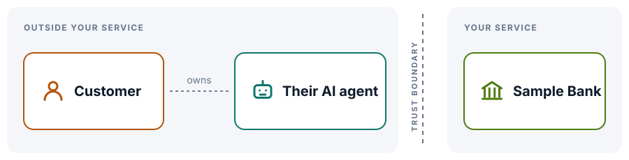
</picture>

- [Credits](#credits)
- [The problem](#the-problem)
- [The approach](#the-approach)
- [Try it yourself](#try-it-yourself)
- [The demo, beat by beat](#the-demo-beat-by-beat)
- [Under the hood](#under-the-hood)
- [Inside ThunderID](#inside-thunderid)
- [What this sample does not do](#what-this-sample-does-not-do)
- [Repository layout and scripts](#repository-layout-and-scripts)
- [Troubleshooting](#troubleshooting)
- [About ThunderID](#about-thunderid)

## The problem

Your customers are starting to send their own AI agents to your service: an assistant that checks a balance,
pays a bill, or books a table. The agent runs on the customer's laptop or in someone else's cloud. You didn't
build it, you can't inspect it, and you can't hand it a secret and hope it keeps it.

So when a request arrives, the old answers don't fit:

- **The customer's password or session?** Then the agent *is* the customer, with all of their access, and you
  can't tell it apart from them or stop it without locking them out.
- **An API key?** Then it's a bearer secret with no owner attached, no consent, and nobody to ask before it is
  used.

What you actually want to know on every request is four things: *which agent is this, who does it act for, what
did that person allow it to do, and is that still true right now?*

## The approach

**Make the agent its own identity, bound to its owner and approved by them.** The bank never deals with the
agent's secrets. It relies on an identity layer, here ThunderID, for four things:

| Beat | What happens | What the bank gets |
| --- | --- | --- |
| **Register** | The agent registers *itself*, and its owner approves it from an email link. | An agent that exists only because a known customer said so. |
| **Distinct credentials** | The agent has its own key pair. The private key never leaves the agent's machine. | A client that proves who it is, separate from its owner. |
| **Delegate** | The owner signs in and consents to specific permissions. | A token that names the owner (`sub`) *and* the agent (`act.sub`), for the bank only, with only the approved scopes. |
| **Revoke** | The owner, or the bank's administrator, suspends the agent. | The very next request is refused. |

<picture>
  <source media="(prefers-color-scheme: dark)" srcset="docs/images/approach-dark.svg">
  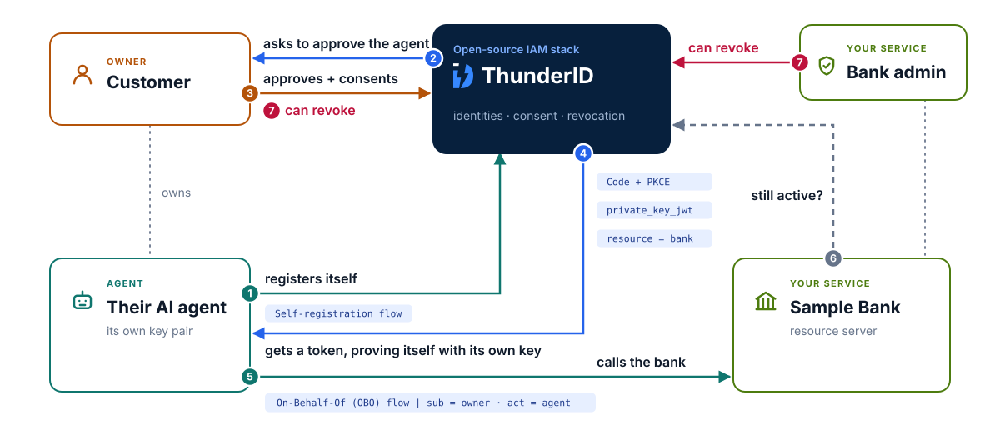
</picture>

1. The agent **registers itself** with ThunderID. It gets nothing usable yet: no token, no client ID.
2. ThunderID **asks the owner to approve** the agent, with a one-time link sent to their email.
3. The owner **approves**, and later **consents** to what the agent may do.
4. The agent **gets a token**, proving itself with its own key (authorization code + PKCE, `private_key_jwt`, `resource` = the bank).
5. The agent **calls the bank** on its owner's behalf: the token's `sub` is the owner and its `act` is the agent.
6. The bank **asks ThunderID whether the token is still active**, on every request.
7. The owner, or the bank's administrator, **can revoke** the agent at any time.

## Try it yourself

Everything runs on your machine. The cast:

| Part | What it is | Where |
| --- | --- | --- |
| **ThunderID** | The open-source IAM stack: users, agents, sign-in flows, consent, tokens, revocation | https://localhost:8090 |
| **Sample Bank portal** | Where john signs in, connects and manages his assistant. Also the bank's admin dashboard. | http://localhost:5173 |
| **Bank API** | The resource server the agent calls | http://localhost:4000 |
| **Sample inbox** | A local SMTP server and web inbox that catch the approval email | http://127.0.0.1:8788 |
| **The agent** | [Claude Code](https://claude.com/claude-code), with the bank's toolkit and skill, which it downloads itself | your terminal |

### What you need

- macOS or Linux, with `curl`, `openssl`, `unzip`, `lsof` and `perl` (all usually present).
- [Node.js](https://nodejs.org) 22 or later.
- [mkcert](https://github.com/FiloSottile/mkcert), with its local certificate authority installed once:
  `mkcert -install`. ThunderID and the agent's key server both use mkcert certificates, so your browser and
  ThunderID trust them without warnings.
- [Claude Code](https://claude.com/claude-code), which plays the agent. Any agent that can run a Node.js script
  and follow instructions can stand in for it.
- A ThunderID release archive, `thunderid-gateway-<version>-<os>-<arch>.zip`, version 2.0.0 or later, from the
  [ThunderID releases](https://github.com/thunder-id/thunderid/releases). Until 2.0.0 is published, build it
  from the `main` branch (this sample was tested with commit `34efb15c`):

  ```bash
  git clone https://github.com/thunder-id/thunderid.git
  cd thunderid
  make build
  ```

  The build needs Go, Node.js 24 and pnpm (see ThunderID's `README.md`), and leaves the archive in
  `target/dist/`.

### Set up and start

```bash
git clone https://github.com/janakamarasena/thunderid-personal-agents-sample.git
cd thunderid-personal-agents-sample
scripts/setup.sh path/to/thunderid-gateway-<version>-<os>-<arch>.zip
scripts/start.sh
```

`setup.sh` runs once. It creates `.env` with this installation's secrets, unpacks ThunderID into `./thunderid`,
gives ThunderID an mkcert certificate, runs ThunderID's own setup, and imports the bank's configuration
([`thunderid-config/bank-sample.yaml`](thunderid-config/bank-sample.yaml)). `start.sh` starts ThunderID and the
Sample Bank in the background and prints the URLs. Logs go to `./logs`.

Demo accounts: **john / john** (also carol and bob) for the bank, and **admin** with the `ADMIN_PASSWORD` from
`.env` (`admin` unless you changed it) for the bank's admin dashboard and ThunderID's Console.

## The demo, beat by beat

Start the agent in an empty folder, so it starts fresh:

```bash
mkdir -p ~/bank-agent && cd ~/bank-agent && claude
```

### 1. Register: the agent asks to exist, the owner approves

1. Open http://localhost:5173, **Sign in** as `john` / `john`, and open **Assistants**.

   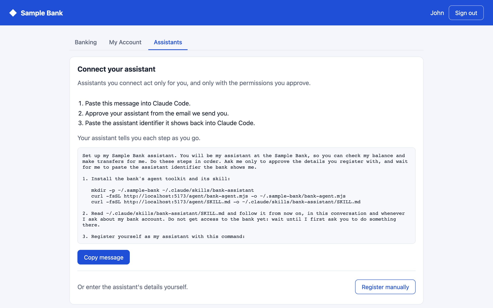

2. Click **Copy message** and paste it into Claude Code. The message tells the agent to download the bank's
   toolkit (`~/.sample-bank/bank-agent.mjs`) and skill (`~/.claude/skills/bank-assistant`), then register
   itself. It shows you what it will submit (its name, model and purpose) and waits for your go-ahead.
3. The agent runs `register`. It drives ThunderID's self-registration flow and ends with **no token and no
   client ID**: the next step needs a link only the owner has.
4. Open the sample inbox at http://127.0.0.1:8788. There is an email from Sample Bank. Open its link: ThunderID
   asks **Approve your assistant?** Click **Approve**.

   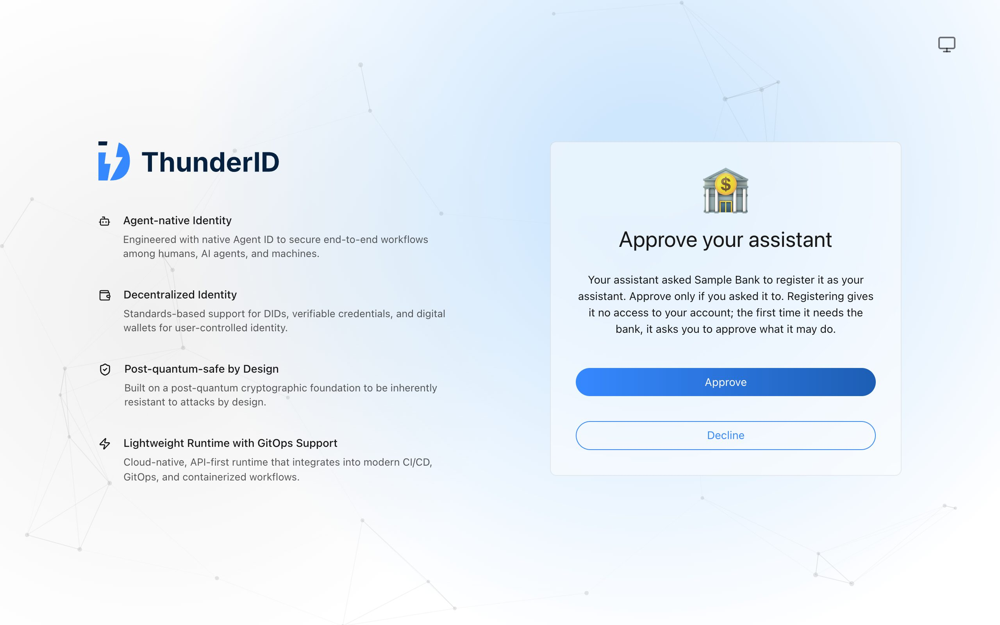

5. The page shows the **assistant identifier** (the agent's OAuth `client_id`). Paste it into Claude Code,
   which runs `finish-registration`.

**Look in ThunderID:** open the Console at https://localhost:8090/console (admin), then **Agents** →
**Personal agents**. The agent is there as *Personal*, owned by john. Its page shows *On behalf of a user:
Enabled*, *Allowed users: Owner only*, and the model and provider it registered with. In the portal, john's
**Assistants** tab lists it too.

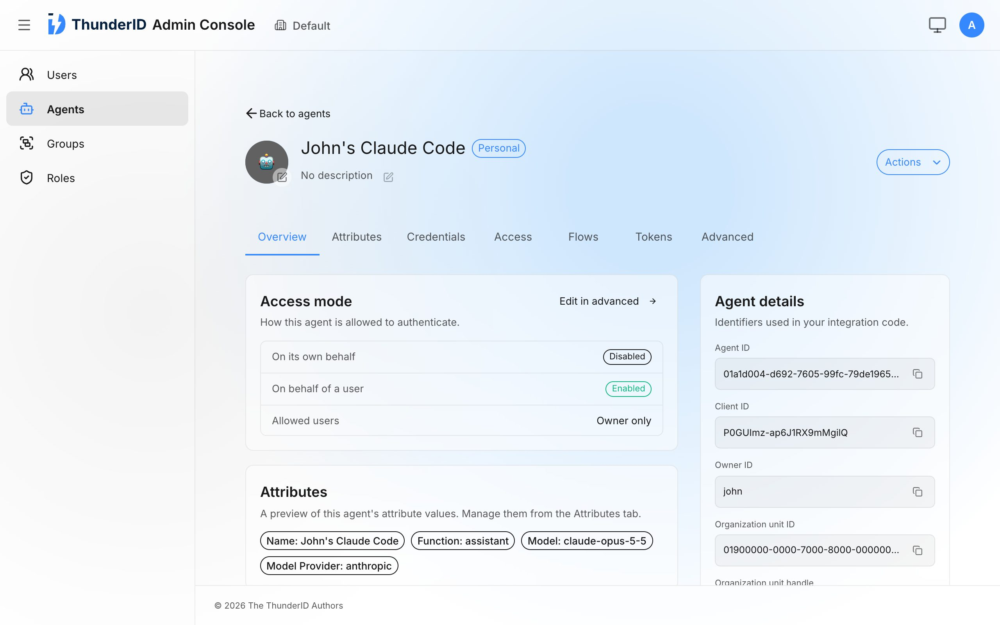


### 2. Distinct credentials: the agent's own key

During registration the toolkit created a key pair in `~/.sample-bank/.keys` and gave ThunderID the address of
its public key (a JWKS at `https://localhost:7070/.well-known/jwks.json`). ThunderID created the agent as an OAuth
client that can only use the authorization code grant, must use PKCE, and authenticates with `private_key_jwt`.
**It has no client secret.** The private key never leaves your machine.

### 3. Delegate: the owner signs in and consents

1. Ask Claude Code: **"What's my bank balance?"**
2. The agent runs `login`. A browser tab opens on ThunderID: **Sign in to approve your assistant**. Sign in as
   `john` / `john`. ThunderID accepts only the agent's owner here: bob can't approve john's agent.
3. Consent lists `bank:read` and `bank:write`. To see scopes at work, turn on **only `bank:read`** and click
   **Allow**.

   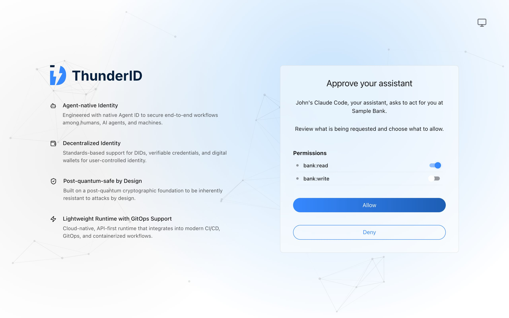

4. The agent answers with the balance ($5,000).
5. Now ask: **"Send 25 to Bob for lunch."** The bank refuses with `403 insufficient_scope` (`bank:write is
   required`), and the agent explains that you didn't grant that permission.
6. Ask it to connect to the bank again. Approve both permissions this time, then ask for the transfer again:
   it goes through. In the portal, john's transactions show it, made by the assistant.

   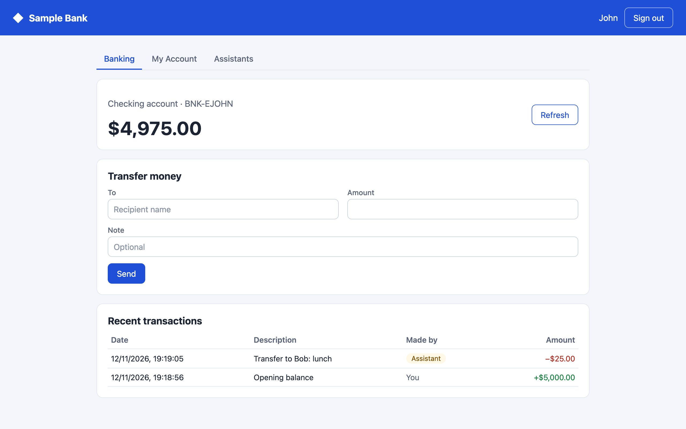


The token the agent now holds says, in standard claims, *john, acting through this agent, for the bank, with
these scopes*:

```json
{
  "sub": "bank-sample-john",
  "act": { "sub": "<the agent's ID in ThunderID>" },
  "client_id": "<the assistant identifier>",
  "aud": "https://bank.sample.local/api",
  "scope": "openid bank:read bank:write"
}
```

### 4. Revoke: suspend, and the next call fails

1. In the portal, **Assistants** → **Suspend** next to the agent, and confirm. It now shows *Suspended by you*.

   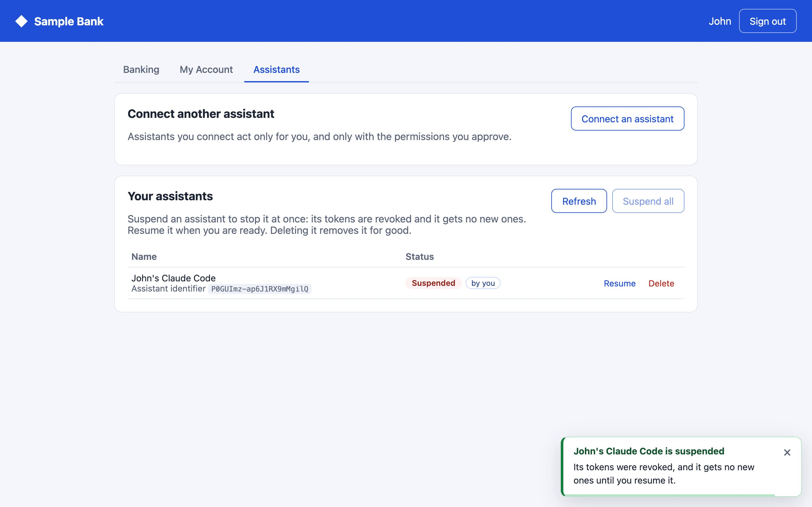

2. Ask Claude Code for the balance again. The bank refuses with `401 invalid_token`: *the token is no longer
   active*. The token hasn't expired. The bank asked ThunderID, and ThunderID said no.
3. The agent can't sign in again either: ThunderID answers `unauthorized_client` while it's suspended.
4. **Resume** it in the portal and the agent can sign in again, with a new token. The old one stays revoked.
   Wait about 30 seconds after suspending before you resume: tokens issued within 30 seconds of a suspension
   are revoked too.

### The bank's side: the admin dashboard and the cascade

Open http://localhost:5173/admin and sign in as admin. The dashboard calls ThunderID's management API:

- **Users** lists each customer with their personal agents. **Agents** lists every agent, personal or not.
- Open **john** and **Suspend account**. The activity log shows the cascade: the account is suspended, and so is
  *John's Claude Code, suspended with the owner's account*. The agent's token stops working at once, because
  its `sub` is john.

  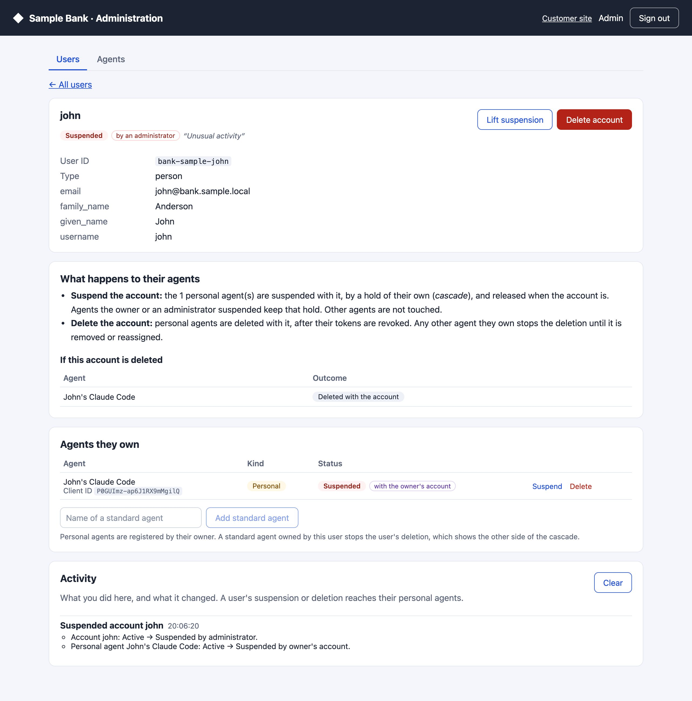

- **Lift suspension** releases the agent's hold. ThunderID keeps john's account *Locked* until an administrator
  clicks **Unlock**.
- **Add standard agent** creates an agent the bank manages for john. The preview under *If this account is
  deleted* then shows it **blocks the deletion**, while john's personal agents would be deleted with him.

To run the demo again, suspend and delete the agent in the portal, then:

```bash
scripts/reset.sh
```

It removes the agent's toolkit and skill from your home folder, empties the inbox, and reopens john's account
at $5,000. Sign out of the portal and start a new Claude Code session.

## Under the hood

The five flows of the demo, message by message, with the specification each follows. Where a step uses
ThunderID's own API rather than a published standard, the table says so.

Legend: **solid** arrows are requests, **dashed** are responses or redirects, **dotted amber** is something the
owner does, and **red** carries a credential.

### Flow 1. Self-registration: the agent asks to exist

The agent's toolkit drives ThunderID's registration flow through the flow API. Each response says which inputs
the next step wants. The flow belongs to an application with no OAuth client, so nothing here can produce a
token.

<picture>
  <source media="(prefers-color-scheme: dark)" srcset="docs/images/flow-1-self-registration-dark.svg">
  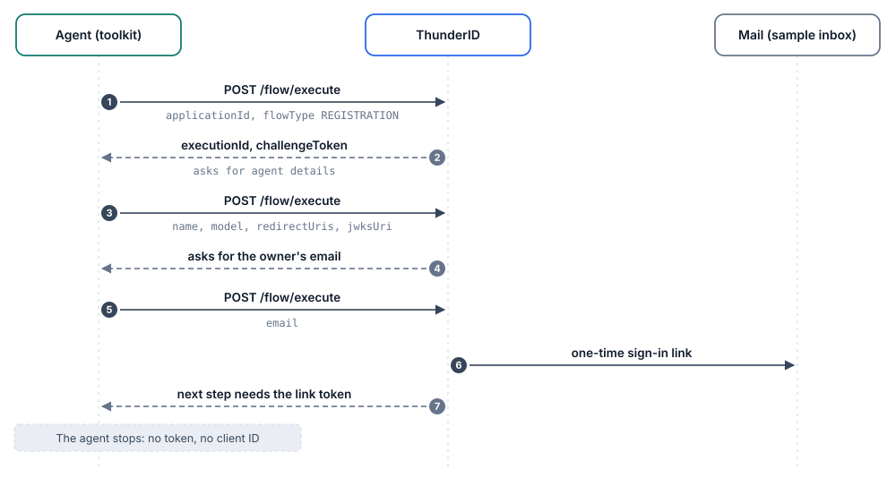
</picture>

| # | Message | Spec |
| --- | --- | --- |
| 1–2 | Start the flow. ThunderID answers with an execution ID and a challenge token that changes every step. | ThunderID flow API |
| 3–4 | The agent submits its name and model, its redirect URI `https://localhost:7070/callback`, and its JWKS URI `https://localhost:7070/.well-known/jwks.json`. | ThunderID flow API, RFC 7517 (JWKS) |
| 5–6 | The agent names its owner by email. ThunderID emails that user a link. If no user has that email, nothing is sent, and the agent can't tell the difference. | ThunderID magic link |
| 7 | The next step needs the link's token, which only the owner has. The agent's part ends here. | ThunderID flow API |

**Result:** a pending request for an identity, which goes nowhere unless the named owner acts on it.

### Flow 2. Owner approval: the human binds the agent to themselves

The emailed link continues the same flow in the owner's browser. Opening it signs the owner in, and they approve.
ThunderID then creates the agent as an OAuth client owned by that user.

<picture>
  <source media="(prefers-color-scheme: dark)" srcset="docs/images/flow-2-owner-approval-dark.svg">
  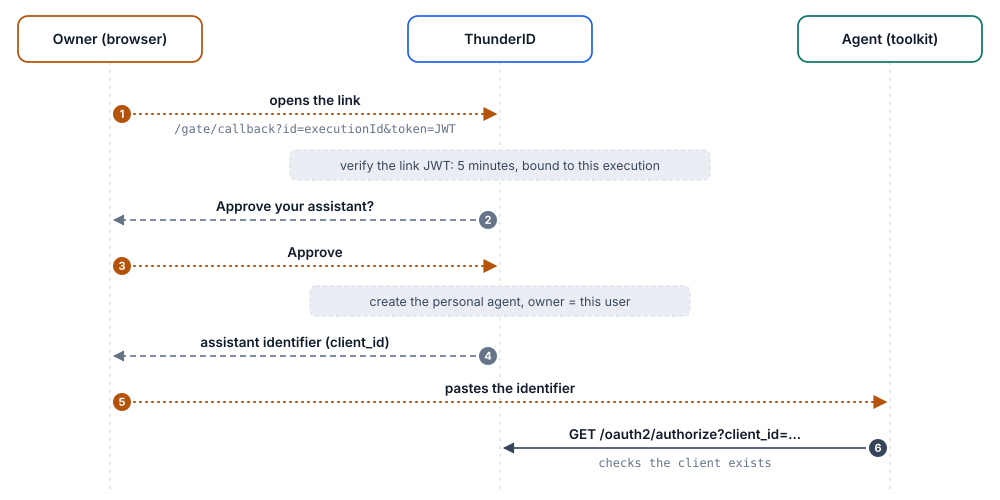
</picture>

| # | Message | Spec |
| --- | --- | --- |
| 1 | The link carries a JWT signed by ThunderID, with the user as `sub`, a 5-minute expiry and the flow's execution ID. It works only for this execution. | ThunderID magic link, RFC 7519 (token format) |
| 2–3 | The owner approves or declines. | ThunderID flow API |
| 3 | On Approve, ThunderID creates the agent as a client allowed only the authorization code grant, with PKCE required, `private_key_jwt` authentication through the JWKS URI, no client secret, and consent on every sign-in. | Client metadata per RFC 6749, RFC 7636, RFC 7523; created by ThunderID, not RFC 7591 |
| 4–5 | The page shows the new `client_id`, which the owner pastes into the agent. | ThunderID |
| 6 | The toolkit makes an authorize request only to confirm the client ID is valid. | RFC 6749 |

**Result:** an OAuth client bound to one owner, with its own public key and no grant that works without that
owner.

### Flow 3. Delegation: an authorization code flow only the owner can complete

Standard OAuth. The agent sends the owner to ThunderID, the owner signs in and consents, and the agent redeems
the code while proving its own identity with a signed assertion.

<picture>
  <source media="(prefers-color-scheme: dark)" srcset="docs/images/flow-3-delegation-dark.svg">
  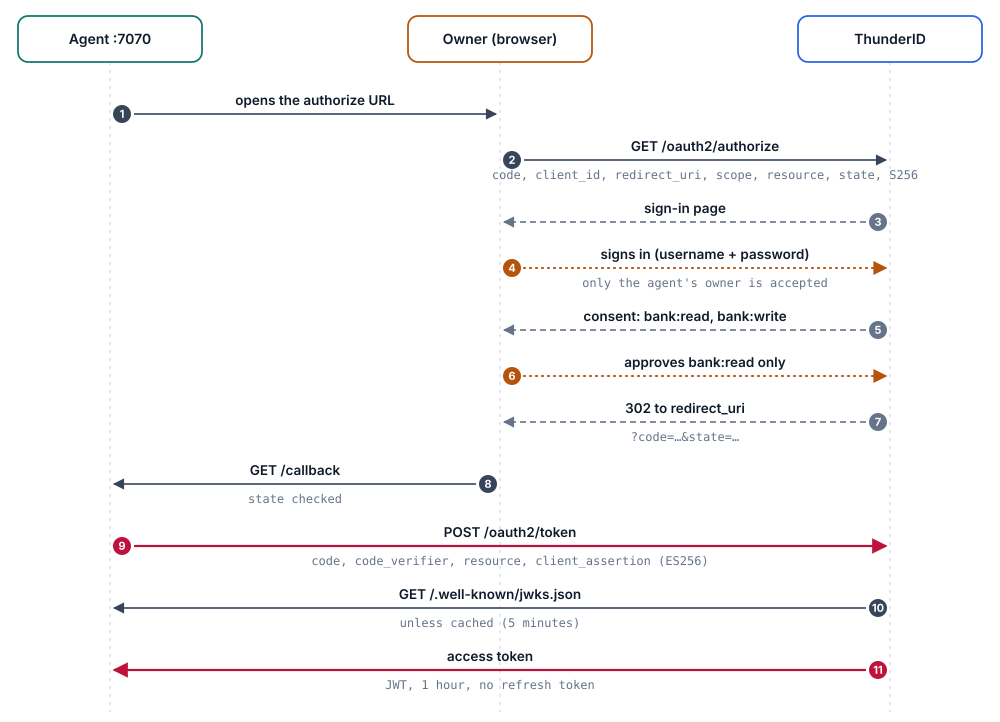
</picture>

| # | Message | Spec |
| --- | --- | --- |
| 1–2 | Authorization request with `code_challenge` = base64url(SHA-256(verifier)), method S256, and `resource` naming the bank API. | RFC 6749 §4.1, RFC 7636, RFC 8707, OIDC Core |
| 3–4 | The owner signs in. ThunderID accepts only the user who owns this agent; anyone else is refused. | Owner-only rule: ThunderID |
| 5–6 | Consent lists the requested scopes. The token gets the scopes the owner both holds through their roles and approves here. | RFC 6749 §3.3 (scope) |
| 7–8 | Redirect back to the agent's local server with the code and `state`, which the agent checks. | RFC 6749 §4.1.2 |
| 9 | Token request with the PKCE verifier and a client assertion: a JWT the agent signs with its private key (ES256), with `iss` = `sub` = client_id, `aud` = ThunderID's issuer, a 60-second lifetime and a unique `jti`. | RFC 6749 §4.1.3, RFC 7636 §4.5, RFC 7523, OIDC Core §9 |
| 10 | ThunderID fetches the agent's public key from its JWKS URI and checks the signature, then the PKCE verifier. | RFC 7517, RFC 7515 |
| 11 | Access token: a JWT for the bank only, naming the owner in `sub` and the agent in `act`. Valid one hour; no refresh token, so the owner signs the agent in again after that. | RFC 9068, RFC 8693 §4.1 (`act`), RFC 8707 (`aud`) |

**Result:** three separate proofs before a token exists. The owner authenticates and consents, the agent proves
it holds its key, and PKCE ties the code to this run of the agent.

> **On "On-Behalf-Of":** no token exchange (RFC 8693 §2) happens. ThunderID puts the RFC 8693 `act` claim on an
> ordinary authorization code token because the client is an agent.

### Flow 4. Calling the bank: local checks plus introspection, every time

The bank validates the JWT itself, then asks ThunderID whether it's still active. Only that second step can
reveal a revocation, so the bank does it on every request and refuses if ThunderID can't answer.

<picture>
  <source media="(prefers-color-scheme: dark)" srcset="docs/images/flow-4-calling-the-bank-dark.svg">
  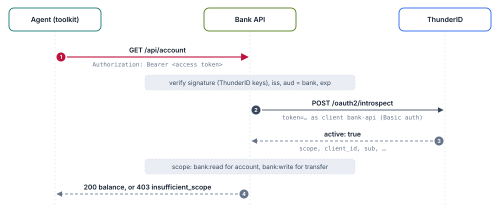
</picture>

| # | Message | Spec |
| --- | --- | --- |
| 1 | The agent presents the token as a bearer token. | RFC 6750 §2.1 |
| · | The bank checks the signature against ThunderID's published keys, then the issuer, the audience (the bank's resource identifier) and expiry. | RFC 9068 §4, RFC 7519, OIDC Discovery |
| 2–3 | Introspection, with the bank authenticating as its own OAuth client. ThunderID answers `active: false` for a revoked token. | RFC 7662; client auth RFC 6749 §2.3.1 |
| 4 | Scope check. A transfer with only `bank:read` gets 403 `insufficient_scope` in a JSON body. A transfer that succeeds is recorded against the owner (`sub`), made by the agent (`act.sub`). | Error code from RFC 6750 §3.1 |

If ThunderID can't be reached for introspection, the bank answers `503 temporarily_unavailable` rather than
trust a token it can't check. The code is in [`sample-bank/backend/auth.mjs`](sample-bank/backend/auth.mjs).

### Flow 5. Revocation: suspend, and the next introspection says no

Suspension uses ThunderID's own APIs. It marks the agent's existing tokens as revoked, which introspection then
reports, and puts a hold on the agent so it can't get new ones.

<picture>
  <source media="(prefers-color-scheme: dark)" srcset="docs/images/flow-5-revocation-dark.svg">
  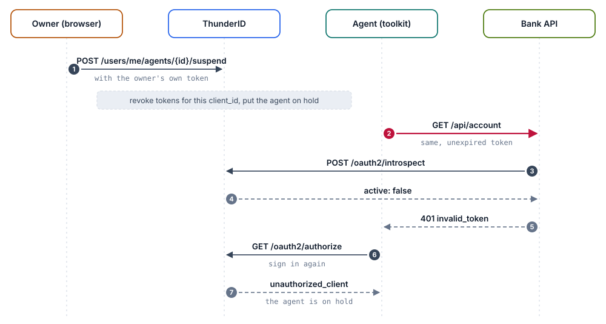
</picture>

| # | Message | Spec |
| --- | --- | --- |
| 1 | The owner suspends the agent from the portal, calling ThunderID's self-service API with their own token. A token carrying `act` is refused there, so an agent can't suspend or delete agents. | ThunderID self-service API |
| 2–5 | The agent's next call fails at introspection, though the token hasn't expired. | RFC 7662, RFC 6750 §3.1 (`invalid_token`) |
| 6–7 | A new sign-in is refused at the authorization endpoint while the hold lasts. | RFC 6749 §4.1.2.1 (`unauthorized_client`) |

| Action | Through | Live token | New tokens |
| --- | --- | --- | --- |
| Owner suspends the agent | Portal, self-service API | Refused at the next call | Blocked |
| Admin suspends the agent | Admin dashboard, ThunderID admin flow | Refused | Blocked |
| Admin suspends john | Admin flow; john's personal agents are suspended with him | Refused (its `sub` is john) | Blocked |
| Resume | Each party lifts only its own hold | Stays revoked | Allowed again; sign in anew |
| Delete the agent | Portal or admin dashboard | **Not revoked** by the delete | Blocked (the client is gone) |
| Delete john | Admin dashboard | Revoked, then his personal agents are deleted | Blocked |

> **For the revoke beat, use Suspend.** Deleting an agent removes its client, so it can't get new tokens, but
> the delete doesn't revoke the token it already holds. Suspend first, then delete if you want it gone.

<details>
<summary><b>Specifications at a glance</b></summary>

| Specification | Where it's used |
| --- | --- |
| RFC 6749 OAuth 2.0 | The authorization code grant the agent uses to get its token (flow 3). |
| RFC 7636 PKCE | S256 code challenge on authorize, verifier on the token request. ThunderID requires it for agent clients, as OAuth 2.1 does. |
| RFC 8707 Resource Indicators | `resource=https://bank.sample.local/api` on the authorize and token requests; it becomes the token's `aud`. |
| RFC 7523 JWT client authentication (`private_key_jwt`, also OIDC Core §9) | How the agent proves it is the registered client at the token endpoint, signing with its own key. |
| RFC 7517 JWK / JWKS; RFC 7515, 7518, 7519 (JWS, ES256, JWT) | The agent publishes its public key as a JWKS; all tokens and assertions are signed JWTs. |
| RFC 9068 JWT access token profile | The access token is a JWT with `typ: at+jwt` and the profile's core claims. |
| RFC 8693 §4.1 `act` (actor) claim | The token names the agent in `act.sub` and the owner in `sub`. Only the claim is used; there's no token-exchange request. |
| RFC 7662 Token Introspection | The bank asks ThunderID on every request whether the token is still active (flow 4). This is how revocation reaches the bank. |
| RFC 6750 Bearer tokens | The agent sends `Authorization: Bearer`. The bank reports `insufficient_scope` in a JSON body rather than the `WWW-Authenticate` header the RFC describes. |
| OIDC Core and Discovery | The `openid` scope, and `/.well-known/openid-configuration` for endpoints, issuer and keys. |
| ThunderID APIs: flow API, magic link, self-service and admin suspension | Agent self-registration and owner approval (flows 1–2) and suspension (flow 5). These flows use no Dynamic Client Registration (RFC 7591) and no token revocation endpoint (RFC 7009). |

</details>

### The client assertion

What the agent signs to prove it is the registered client (RFC 7523), sent with
`client_assertion_type=urn:ietf:params:oauth:client-assertion-type:jwt-bearer`:

```jsonc
// header
{ "alg": "ES256", "typ": "JWT", "kid": "<key ID>" }
// payload, signed with the agent's private key, which never leaves the machine it runs on
{
  "iss": "<client_id>",
  "sub": "<client_id>",
  "aud": "<ThunderID's issuer>",
  "iat": "<now>",
  "exp": "<now + 60 seconds>",
  "jti": "<random>"
}
```

ThunderID rejects a reused `jti`. The code is in
[`sample-bank/backend/agent/bank-agent.mjs`](sample-bank/backend/agent/bank-agent.mjs).

## Inside ThunderID

The whole bank setup in ThunderID is one declarative file,
[`thunderid-config/bank-sample.yaml`](thunderid-config/bank-sample.yaml), imported with `POST /import`. Reading it
top to bottom is the best way to see how the demo is built:

| Resource | What it is |
| --- | --- |
| Resource server **Bank API** | `https://bank.sample.local/api`, with the permissions `bank:read`, `bank:write` and `bank:admin`. |
| Users **john, carol, bob** | Demo customers. |
| Roles **Bank Customer**, **Bank Admin** | Customers get read and write; ThunderID's Administrators group gets admin too. A token never gets a scope its user doesn't hold through a role. |
| Application **Bank Portal** | The portal's browser client (code + PKCE). |
| Flow **Bank Portal Sign-in Flow** | Username and password, then the authorization check. |
| Flow **User and Personal Assistant Registration Flow** | The portal's *Register manually* option. |
| Application **Bank Assistant Registration** | Has no OAuth client: it only runs the self-registration flow for agents. |
| Flow **Personal Assistant Self Registration Flow** | Flow 1: what the agent drives with `register`. |
| Flow **Personal Assistant Registration Approval Flow** | Flow 2: the magic link and the *Approve your assistant* page. |
| Flow **Personal Assistant Sign-in Flow** | Flow 3: owner-only sign-in and consent, bound to every agent the registration creates. |
| Connection **Sample SMTP server** | Where the approval email goes. |
| Application **Bank API** | The bank's own client, for introspection. Its secret is a `sec:` reference, filled in from ThunderID's secret store at import. |
| Agent **bank-audit-agent** | A standard agent the bank runs itself, owned by the administrator. |
| Server configuration **cors** | Lets the portal call ThunderID from the browser. |

**In ThunderID's Console** (https://localhost:8090/console, admin): **Users** shows john, carol and bob;
**Agents** shows every agent, with a **Personal agents** tab for the ones customers registered. An agent's page
shows its kind, its owner, how it may authenticate (*On behalf of a user*, *Owner only*), its attributes and its
credentials. The Console of this ThunderID release manages users, agents, groups and roles. Applications,
connections and flows are managed through the REST API and declarative YAML, as here, or through ThunderID's
Control Plane, which has a visual flow designer.

## What this sample does not do

Worth stating precisely, especially to an identity audience:

- **Revocation reaches the bank only through introspection.** The bank asks ThunderID on every request. Nothing
  is pushed to it: no Shared Signals (SSF/CAEP) events and no webhooks.
- **"On-Behalf-Of" is not RFC 8693 token exchange.** The `act` claim is added to an ordinary authorization code
  token.
- **Registration and suspension are ThunderID's own APIs,** not Dynamic Client Registration (RFC 7591) or the
  token revocation endpoint (RFC 7009).
- **No refresh tokens.** The agent's token lasts an hour; then the owner signs it in again.
- **It's a local demo.** Demo passwords, `localhost` everywhere, one agent per owner session.

## Repository layout and scripts

```
├── thunderid-config/bank-sample.yaml   The bank's ThunderID configuration (imported once by setup)
├── sample-bank/
│   ├── backend/          Bank API (Node.js): token checks in auth.mjs
│   │   └── agent/        The agent's toolkit (bank-agent.mjs) and skill (SKILL.md), served to the agent
│   ├── bank-portal/      Customer portal and admin dashboard (Vue)
│   ├── smtp-server/      Local SMTP server and web inbox
│   └── start.mjs         Runs the three together
├── scripts/              Setup and run scripts, below
└── docs/images/          The diagrams in this README
```

| Script | What it does |
| --- | --- |
| `scripts/setup.sh <release.zip>` | One-time setup: secrets, ThunderID, certificate, configuration import. |
| `scripts/start.sh` | Starts ThunderID and the Sample Bank in the background. |
| `scripts/stop.sh` | Stops everything the demo started. |
| `scripts/reset.sh` | Resets the demo for another run, without touching ThunderID. |
| `scripts/generate-secrets.sh` | Creates `.env` (setup runs it for you). |
| `scripts/import-config.sh` | Imports the configuration again. Live tokens of the applications it updates are revoked. |

**Secrets stay out of the repository.** `generate-secrets.sh` creates `.env` with a random management API key
and a random client secret for the bank API. ThunderID keeps only the key's SHA-256 digest, and gets the client
secret through its secret store. `.env`, `thunderid/` and `logs/` are ignored by git.

To start over completely: `scripts/stop.sh`, delete `thunderid/` and `.env`, and run `scripts/setup.sh` again.

## Troubleshooting

- **`mkcert: command not found` right after installing it.** Homebrew may not be on your `PATH` in that shell.
  Open a new terminal, or run `eval "$(/opt/homebrew/bin/brew shellenv)"`.
- **The portal shows "The browser cannot call ThunderID", or the console shows a CORS error.** Check the
  certificate first: open https://localhost:8090. A certificate warning means mkcert's authority isn't trusted:
  run `mkcert -install` and restart the browser. An untrusted certificate shows up as a CORS error in the
  browser's console.
- **ThunderID's setup or start says port 8090 is in use, but nothing runs there.** A browser tab may still hold
  a connection to it. Close the tab. Don't use the `kill -9 $(lsof -ti tcp:8090)` it suggests: that kills the
  browser. `scripts/setup.sh` makes ThunderID's scripts check only for a listening server.
- **After importing again, the portal says the account could not be loaded.** The import revoked the portal's
  token. Sign out and in again.
- **After lifting a suspension, john can't sign in.** ThunderID keeps the account locked until an administrator
  unlocks it in the admin dashboard.

## About ThunderID

[ThunderID](https://thunderid.dev) is an open-source IAM stack for humans, AI agents and machines, and a project
of [LF Decentralized Trust](https://www.lfdecentralizedtrust.org). It's lightweight, configured declaratively
(this whole demo is one YAML file), and licensed under Apache 2.0.

- Website and documentation: https://thunderid.dev
- Source: https://github.com/thunder-id/thunderid

## License

Apache License 2.0. See [LICENSE](LICENSE).
